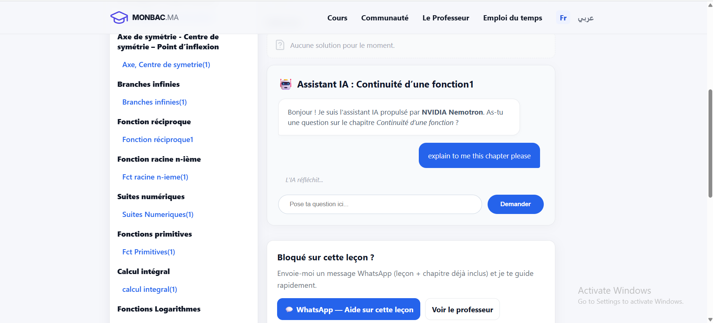
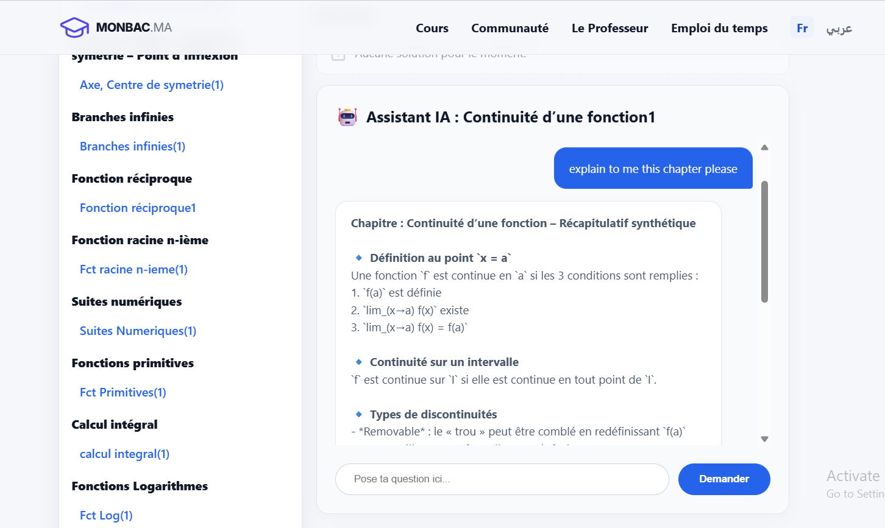

# MonBac: AI-Powered Learning Management System 🎓🤖

**Built for the Nebius x NVIDIA Global AI Hackathon**  
**Track:** Best Apps and Agents

 


## 🚀 Overview
MonBac is a full-stack Learning Management System (LMS) designed for high school and college students. For this hackathon, we supercharged the platform by integrating an **AI Course Tutor** powered by NVIDIA's Nemotron models. 

Instead of a generic chatbot, the MonBac AI Tutor is context-aware. When a student asks a question within a specific lesson, the system invisibly passes the current chapter and lesson metadata to the AI, ensuring highly accurate, curriculum-specific answers without hallucinations.

## 🧠 How We Used Nebius & NVIDIA
*   **Model:** `nvidia/Nemotron-3_5-Lightning`
*   **Infrastructure:** Nebius AI Cloud (Serverless Endpoints)
*   **Integration:** We utilized the OpenAI Node.js SDK to route prompts directly to Nebius endpoints. We chose the *Lightning* model because its low latency is critical for maintaining a responsive, real-time chat interface for students studying complex subjects.

## 🛠️ Tech Stack
*   **Frontend:** EJS (Embedded JavaScript), HTML5, CSS3 (Logical Properties for LTR/RTL support), Vanilla JS (Fetch API/AJAX)
*   **Backend:** Node.js, Express.js (CommonJS modules)
*   **AI API:** Nebius / NVIDIA Nemotron

## 💻 Local Setup Instructions

To run this project locally, you will need Node.js installed and an active API key from Nebius.

1. **Clone the repository:**
   ```bash
   git clone https://github.com/Hemdi2004/MonBac.git
   cd MonBac
   ```

2. **Install dependencies:**
   ```bash
   npm install
   ```

3. **Set up environment variables:**
   Create a `.env` file in the root directory and add your Nebius API key:
   ```env
   NEBIUS_API_KEY=your_api_key_here
   PORT=3000
   ```

4. **Start the server:**
   ```bash
   npm start
   ```

The application will be running on `http://localhost:3000`. Navigate to any lesson to test the AI Tutor!

## 📜 License
This project is licensed under the MIT License - see the [LICENSE](LICENSE) file for details.